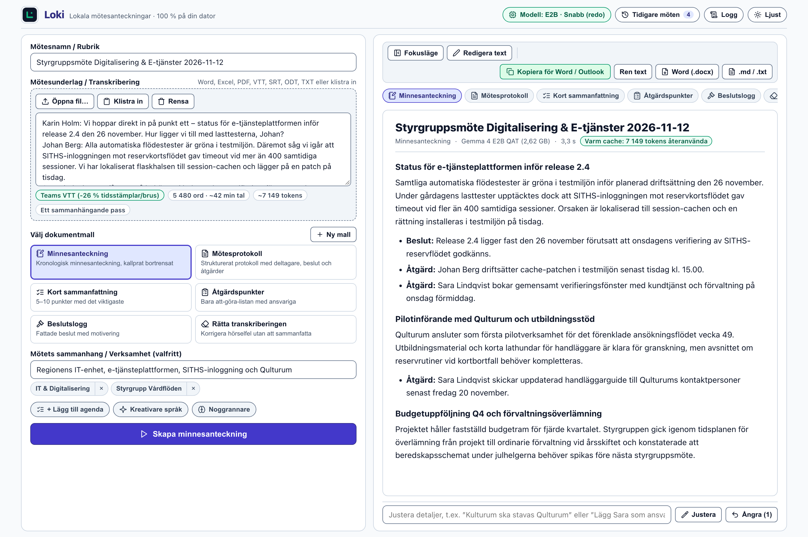
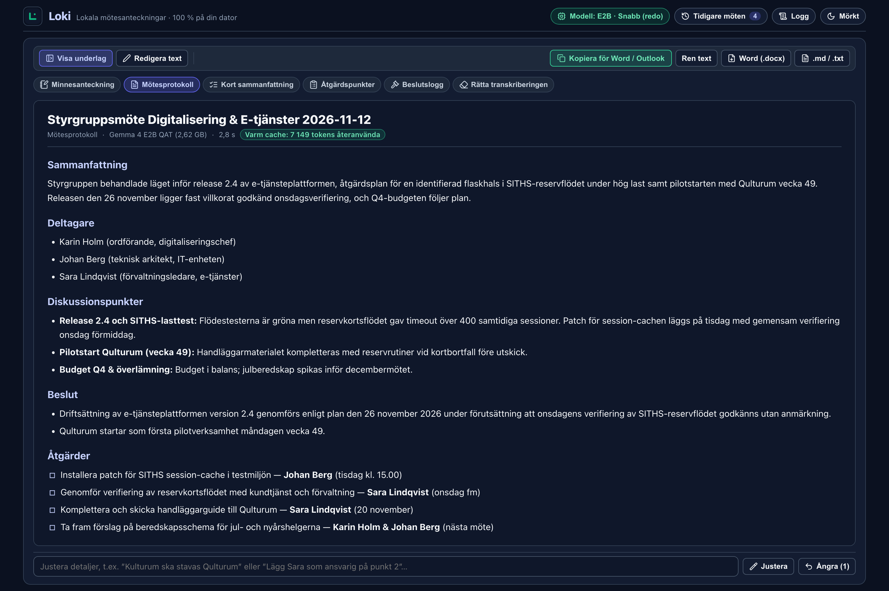
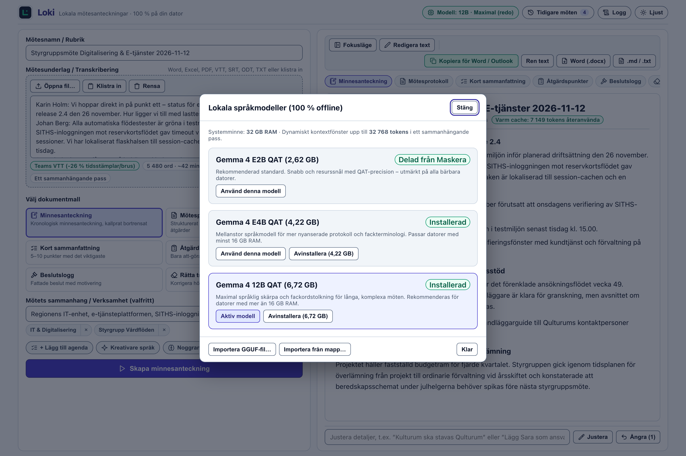

# Loki 3.0 — Lokala mötesanteckningar på din dator

Loki förvandlar råa mötestranskriberingar och underlag till rena, välstrukturerade svenska **minnesanteckningar, mötesprotokoll, beslutsloggar och åtgärdslistor** – **100 % lokalt på din egen dator** utan molntjänster eller externa API-anrop.

---

## Nedladdning (GitHub Releases)

Färdigbyggda versioner för Windows och macOS finns under [GitHub Releases](https://github.com/mrswedish/Loki/releases/latest):

| Paket | Plattform & acceleration | Beskrivning |
|---|---|---|
| **`Loki-portabel.exe`** | Windows x64 (CPU) | Portabel `.exe` utan installation – fungerar på alla Windows-datorer |
| **`Loki-portabel-vulkan.exe`** | Windows x64 (Vulkan GPU + CPU-fallback) | Portabel `.exe` med hårdvaruacceleration för moderna AMD-, Intel- och NVIDIA-kort |
| **`Loki_*_x64-setup.exe` / `.msi`** | Windows x64 | Vanligt installationspaket för Windows |
| **`Loki_*_aarch64.dmg`** | macOS Apple Silicon (Metal GPU) | Native M1/M2/M3/M4-app med full Metal-acceleration |

---

## Gränssnitt & arbetsflöde

### 1. Tvåkolumns arbetsyta — städat mötesunderlag och färdig minnesanteckning (Ljust tema)


### 2. Fokusläge & 1-klicks mallbyte på varm mötescache — Mötesprotokoll (Mörkt tema)


### 3. Tre lokala språkmodeller (100 % offline & automatisk delning med Maskera)


> **Interaktiv HTML-förhandsvisning:** Filen [`docs/screenshots/loki-ui-demo.html`](docs/screenshots/loki-ui-demo.html) är en fristående HTML-dump som använder applikationens faktiska stilmall ([`src/index.css`](src/index.css)) och kan öppnas direkt i en webbläsare (med `?view=notes`, `?view=protocol&theme=dark`, `?view=models` eller `?view=empty`) för att testa mallbyten, fokusläge och växla mellan **Ljust** och **Mörkt** tema.

---

## Höjdpunkter i Loki 3.0

- **100 % lokalt & integritetssäkert:** All AI-bearbetning, dokumentläsning och möteshistorik stannar på datorn. Noll telemetri och noll externa AI-tjänster.
- **Inbyggd C++/Rust-motor (`llama-cpp-2`):** Ingen extern webbserver eller krånglig installation. Kör direkt med Apple Silicon Metal på Mac samt portabel flerkärnig CPU (`Loki-portabel.exe`) eller Vulkan GPU (`Loki-portabel-vulkan.exe`) på Windows.
- **Varm mötescache – byt mall på ett par sekunder:** När ett möte har lästs in ligger mötesunderlaget kvar varmt i minnet. Växla med ett klick mellan *Minnesanteckning*, *Mötesprotokoll*, *Kort sammanfattning*, *Åtgärdspunkter*, *Beslutslogg*, *Rätta transkriberingen* och egna mallar utan att modellen behöver läsa om mötestexten.
- **Iterativ detaljjustering med Ångra:** Skriv korta följddirektiv längst ner under dokumentet (t.ex. *"Kulturum ska stavas Qulturum"* eller *"Lägg Sara som ansvarig på punkt 2"*) med obegränsad ångra-historik under passet.
- **Bred dokumentimport (utan installerat Office):**
  - **Mötestranskript:** `.vtt`, `.srt` samt inklistrade Teams-/Zoom-transkript (rensar automatiskt bort tidsstämplar och slår ihop repliker från samma talare).
  - **Dokument & Kalkylblad:** Word (`.docx`), OpenDocument (`.odt`), Excel (`.xlsx`, `.xls`, `.ods`), PDF (`.pdf`) samt `.txt`, `.md` och `.csv` (med svensk Windows-1252-fallback).
- **Tre optimerade QAT-språkmodeller:**
  - **Gemma 4 E2B QAT (`2,62 GB`, standard):** Snabb och träffsäker på alla bärbara datorer. *(Delas automatiskt om du redan har Maskera installerad!)*
  - **Gemma 4 E4B QAT (`4,22 GB`, valfri):** Mellanläge för mer nyanserade protokoll och fackterminologi. Passar datorer med minst 16 GB RAM.
  - **Gemma 4 12B QAT (`6,72 GB`, valfri):** Maximal språklig skärpa och fackordstolkning för långa, komplexa möten. Rekommenderas för datorer med mer än 16 GB RAM.
- **Färdigt för Word & Outlook:** Kopiera med riktiga rubriker och punktlistor direkt till urklipp, eller exportera en formaterad **Word-fil (`.docx`)**, `.md` eller `.txt`.

---

## Bygga från källkod

### Förutsättningar
- **Node.js** 20+
- **Rust** (`rustup`, stable)
- På Windows vid eget bygge: LLVM (`LIBCLANG_PATH`) och Visual Studio C++ Build Tools. På macOS: Xcode Command Line Tools.

```bash
npm install
npm run tauri dev
```

För produktionsbygge:

```bash
npm run tauri build
```
